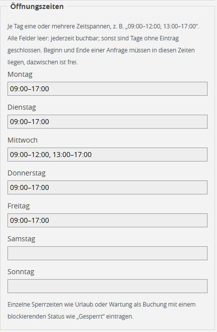

applies: Buchungsmodus Zeitraum, je Objekt
since: 0.7.0

# Öffnungszeiten

Öffnungszeiten legen fest, wann eine Anfrage beginnen und enden darf. Sie gelten im Buchungsmodus „Zeitraum“ und nur für Anfragen über das Frontend.

## Öffnungszeiten eintragen

1. Öffnen Sie im Backend die Seite mit dem Abschnitt und klicken Sie beim Objekt auf **Bearbeiten**.
2. Tragen Sie im Bereich **Öffnungszeiten** für jeden Wochentag eine oder mehrere Zeitspannen ein.
3. Lassen Sie Tage leer, an denen das Objekt geschlossen ist, und klicken Sie auf **Speichern**.

## Schreibweise

| Eingabe | Bedeutung |
|---|---|
| `09:00–17:00` | durchgehend geöffnet |
| `09:00–12:00, 13:00–17:00` | mit Mittagspause; mehrere Spannen durch Komma trennen |
| `9-17` | Kurzform: volle Stunden und ein Bindestrich genügen |
| `00:00–24:00` | den ganzen Tag |
| (leer) | geschlossen, sobald ein anderer Tag Zeiten hat |

> [!NOTE]
> Alle Felder leer heißt: jederzeit buchbar. Erst wenn Sie einen Tag ausfüllen, gelten die übrigen leeren Tage als geschlossen.

## Was die Zeiten bewirken

Beginn und Ende einer Anfrage müssen in den Öffnungszeiten liegen. Was dazwischen liegt, prüft Reservations nicht. So kann ein Gerät am Freitag um 16:00 abgeholt und am Montag um 10:00 zurückgegeben werden, auch wenn am Wochenende geschlossen ist.

- Im Anfrageformular stehen die Öffnungszeiten unter den Datumsfeldern.
- In der Wochenansicht sind geschlossene Zeiten grau schraffiert.
- Der früheste Beginn wird auf die nächste Öffnung verschoben.

> [!WARNING]
> Im Backend gelten die Öffnungszeiten nicht. Buchungen, die Sie selbst eintragen, dürfen auch außerhalb liegen, etwa für eine Veranstaltung am Sonntag.

## Häufige Fragen

### Wie sperre ich einen Feiertag oder Betriebsurlaub?

Legen Sie eine Buchung mit dem Status „Gesperrt“ an. Sie blockiert den Zeitraum, ohne dass Sie die Öffnungszeiten ändern müssen.

### Warum kann ein Besucher 08:00 nicht wählen?

Vermutlich öffnet das Objekt erst später, oder 08:00 liegt nicht auf dem Raster. Das Raster stellen Sie bei den Buchungsregeln des Objekts ein.

### Kann ich Öffnungszeiten für alle Objekte eines Typs vorgeben?

Nein. Öffnungszeiten gehören zum Objekt. Der Objekttyp gibt nur das Raster vor.
