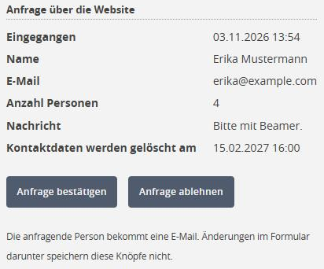

# Anfragen bearbeiten

Mit eingeschalteten Buchungsanfragen steht unter dem Kalender das aufklappbare Formular „Buchung anfragen“. Eine Anfrage wird im Backend zu einer Buchung, die Sie bestätigen oder ablehnen.

## Anfragen einschalten

1. Setzen Sie in den [Einstellungen](settings.md#buchungsanfragen) das Häkchen bei **Buchungsanfragen über die Website annehmen**.
2. Tragen Sie eine Adresse für Benachrichtigungen ein.
3. Prüfen Sie die [Löschfrist](privacy.md) und lassen Sie das Captcha eingeschaltet.
4. Stellen Sie die [Buchungsregeln](booking-rules.md) der Objekte ein.

## Was bei einer Anfrage geschieht

1. Der Besucher füllt das Formular aus, auf Wunsch [vorbelegt per Klick in den Kalender](views.md#direkt-aus-dem-kalender-anfragen). Reservations prüft die Regeln des Objekts und ob der Zeitraum frei ist.
2. Es entsteht eine Buchung mit dem Status der Rolle „neue Anfrage“, mit den Vorgaben also „angefragt“. Sie blockiert den Zeitraum sofort.
3. Der Besucher bekommt eine Eingangsbestätigung, Sie eine Benachrichtigung mit allen Angaben und einem Link ins Backend.
4. Sie bestätigen oder lehnen ab. Die Person bekommt eine Mail.

Ist beim Objekt **Anfragen sofort verbindlich buchen** eingeschaltet, entfällt Schritt 4: Die Buchung ist gleich bestätigt.

## Anfrage bestätigen oder ablehnen

1. Öffnen Sie den Link aus der Mail. Oder sehen Sie in der Objektliste nach: Die Spalte **Offene Anfragen** zeigt, bei welchem Objekt welche warten. Klicken Sie dort auf **Buchungen** und bei der Anfrage auf **Bearbeiten**.
2. Prüfen Sie die Angaben unter **Anfrage über die Website**.
3. Klicken Sie auf **Anfrage bestätigen** oder **Anfrage ablehnen**.

Beim Bestätigen prüft Reservations erneut, ob der Zeitraum frei ist. Nach dem Ablehnen hat die Buchung den Status „abgelehnt“ und gibt den Zeitraum frei. Sie bleibt in der Liste.

> [!NOTE]
> Die beiden Knöpfe speichern keine Änderungen aus dem Formular darunter. Wollen Sie den Zeitraum anpassen, speichern Sie zuerst die Buchung und bestätigen dann.

## Welche Mails verschickt werden

| Anlass | Empfänger |
|---|---|
| Anfrage eingegangen | Besucher und Benachrichtigungsadresse |
| Sofort gebucht | Besucher und Benachrichtigungsadresse |
| Anfrage bestätigt | Besucher |
| Anfrage abgelehnt | Besucher |

Die Mail an den Besucher enthält nur festen Text, Objekt, Zeitraum und, wenn eingetragen, die [An- und Abreisezeit](booking-rules.md#an-und-abreisezeit). Die übrigen Angaben gehen nur an die Benachrichtigungsadresse. Die Mails nutzen den Mailversand von WBCE, in der Sprache der Seite.

Ändern Sie eine Buchung im Formular, geht keine Mail hinaus. Melden Sie sich dann selbst bei der Person.

## Schutz vor Missbrauch

- Formular-Token und ein verstecktes Fallenfeld sind immer aktiv, das Captcha ist einstellbar.
- Ein Formular lässt sich frühestens zwei Sekunden nach dem Anzeigen absenden.
- Je Besucher und Abschnitt sind 3 Anfragen pro Stunde möglich.

Mit dem Captcha ist das Formular gut geschützt. Ohne Captcha können Bots Zeiträume mit falschen Anfragen blockieren, weil jede Anfrage den Zeitraum belegt.
