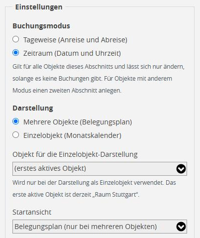

# Einstellungen

Die Einstellungen gelten für einen Abschnitt. Sie erreichen sie über den Link **Einstellungen** oberhalb der Objektliste.

## Buchungsmodus

| Wert | Bedeutung |
|---|---|
| Tageweise | Gebucht wird von Anreise bis Abreise. Ein Wechseltag ist möglich: Die eine Buchung endet am Tag, an dem die nächste beginnt. |
| Zeitraum | Gebucht wird mit Datum und Uhrzeit. Dazu kommen [Raster](booking-rules.md#raster) und [Öffnungszeiten](opening-hours.md). |

> [!WARNING]
> Der Buchungsmodus lässt sich nur ändern, solange der Abschnitt keine Buchungen hat. Ein Wechsel leert die Mindest- und Höchstdauer von Objekten und Objekttypen, denn sie zählen Nächte oder Minuten.

## Darstellung und Startansicht

Die **Darstellung** legt fest, ob der Abschnitt mehrere Objekte zeigt oder ein einzelnes. Bei der Darstellung als Einzelobjekt wählen Sie das Objekt aus. Ohne Auswahl erscheint das erste aktive.

Die **Startansicht** ist die Ansicht, die Besucher zuerst sehen. Nicht jede passt zu jeder Einstellung:

| Startansicht | Verfügbar |
|---|---|
| Belegungsplan | nur bei mehreren Objekten |
| Kalender | nur bei einem Einzelobjekt |
| Woche | nur im Buchungsmodus Zeitraum |
| Liste | immer |

Passt die Startansicht nicht, lehnt das Speichern sie mit einer Meldung ab. Wie die Ansichten aussehen, steht unter [Ansichten](views.md).

## Plan, Beschriftungen und Blättern

| Einstellung | Bedeutung |
|---|---|
| Der Belegungsplan zeigt | 1 oder 3 Monate, bei 3 Monaten als drei Tabellen untereinander |
| Öffentliche Beschriftungen auf der Website zeigen | schaltet die Beschriftung von Buchungen für den ganzen Abschnitt ein oder aus |
| So viele Monate können Besucher zurückblättern | 0 bis 60, Vorgabe 12 |
| So viele Monate können Besucher vorblättern | 1 bis 60, Vorgabe 24 |

> [!NOTE]
> Das Vorblättern begrenzt auch Anfragen. Hat ein Objekt keinen eigenen Höchstvorlauf, darf eine Anfrage spätestens im letzten Monat beginnen, den Besucher erreichen können.

## Objektbeschreibungen aus news_img

Diese Auswahl erscheint, wenn es auf der Website news_img-Abschnitte gibt. Mehr dazu unter [Beschreibung aus news_img](news-img.md).

## Buchungsanfragen

| Einstellung | Bedeutung |
|---|---|
| Buchungsanfragen über die Website annehmen | zeigt das Anfrageformular unter dem Kalender |
| Über neue Anfragen benachrichtigen | Adresse für die Mail bei jeder neuen Anfrage. Leer: keine Mail, die Anfrage steht trotzdem im Backend. |
| Kontaktdaten löschen nach (Tagen) | 1 bis 3650, Vorgabe 90. Mehr unter [Datenschutz und Löschfristen](privacy.md). |
| Captcha verwenden | empfohlen; ohne Captcha können Bots mit falschen Anfragen Zeiträume blockieren. Die Auswahl erscheint nur, wenn das Modul captcha_control installiert ist. |
