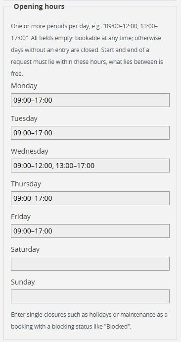

applies: booking by period, per object
since: 0.7.0

# Opening hours

Opening hours decide when a request may start and end. They apply to the booking mode "By period" and only to requests via the website.

## Enter opening hours

1. Open the page with the section in the backend and click **Edit** at the object.
2. Enter one or more periods for each weekday in the area **Opening hours**.
3. Leave days empty on which the object is closed, and click **Save**.

## Notation

| Input | Meaning |
|---|---|
| `09:00–17:00` | open throughout |
| `09:00–12:00, 13:00–17:00` | with a lunch break; separate several periods with a comma |
| `9-17` | short form: full hours and a hyphen are enough |
| `00:00–24:00` | the whole day |
| (empty) | closed, as soon as another day has hours |

> [!NOTE]
> All fields empty means: bookable at any time. Only once you fill in a day do the other empty days count as closed.

## What the hours do

Start and end of a request must lie within the opening hours. Reservations does not check what lies between. So a device can be picked up on Friday at 16:00 and returned on Monday at 10:00, even if it is closed at the weekend.

- The request form shows the opening hours below the date fields.
- The week view shows closed times with grey hatching.
- The earliest start is moved to the next opening.

> [!WARNING]
> Opening hours do not apply in the backend. Bookings you enter yourself may lie outside them, for example an event on a Sunday.

## Frequently asked questions

### How do I block a public holiday or company holidays?

Add a booking with the status "Blocked", see [Blocked periods](blocked-times.md). It blocks the period without any change to the opening hours.

### Why can a visitor not choose 08:00?

Probably the object opens later, or 08:00 is not on the [grid](booking-rules.md#grid).

### Can I preset opening hours for all objects of a type?

No. Opening hours belong to the object. The object type only presets the grid.
