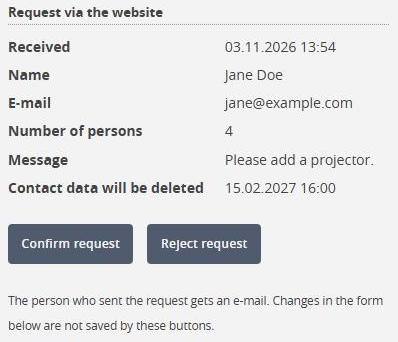

# Handle requests

With booking requests switched on, the collapsible form "Request a booking" appears below the calendar. In the backend a request becomes a booking that you confirm or reject.

## Switch on requests

1. In the [settings](settings.md#booking-requests), tick **Accept booking requests via the website**.
2. Enter an address for notifications.
3. Check the [retention period](privacy.md) and leave the captcha on.
4. Set the [booking rules](booking-rules.md) of the objects.

## What happens with a request

1. The visitor fills in the form. Reservations checks the rules of the object and whether the period is free.
2. A booking is created with the status of the role "new request", by default "Requested". It blocks the period at once.
3. The visitor gets an acknowledgement, you get a notification with all details and a link into the backend.
4. You confirm or reject. The person gets a mail.

If **Book requests at once** is on at the object, step 4 does not apply: the booking is confirmed right away.

## Confirm or reject a request

1. Open the link from the mail. Or look in the object list: the column **Open requests** shows which objects have some waiting. Click **Bookings** there, and **Edit** at the request.
2. Check the details under **Request via the website**.
3. Click **Confirm request** or **Reject request**.

When you confirm, Reservations checks again whether the period is free. After rejecting, the booking has the status "Rejected" and frees the period. It stays in the list.

> [!NOTE]
> The two buttons do not save changes from the form below. If you want to adapt the period, save the booking first and confirm afterwards.

## Which mails are sent

| Occasion | Recipient |
|---|---|
| Request received | visitor and notification address |
| Booked at once | visitor and notification address |
| Request confirmed | visitor |
| Request rejected | visitor |

The mail to the visitor contains only fixed text, the object, the period and, if entered, the [arrival and departure time](booking-rules.md#arrival-and-departure-time). The other details go to the notification address only. The mails use the mail settings of WBCE, in the language of the page.

If you change a booking in the form, no mail goes out. Contact the person yourself in that case.

## Protection against misuse

- Form token and a hidden trap field are always active, the captcha is optional.
- A form can be sent two seconds after it was shown at the earliest.
- Each visitor can send 3 requests per hour and section.

With the captcha the form is well protected. Without it, bots can block periods with fake requests, because each request occupies its period.
