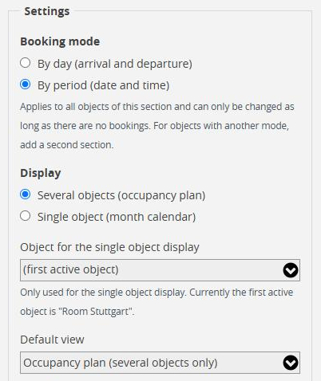

# Settings

The settings apply to one section. You reach them through the link **Settings** above the object list.

## Booking mode

| Value | Meaning |
|---|---|
| By day | Booked from arrival to departure. A changeover day is possible: one booking ends on the day the next one starts. |
| By period | Booked with date and time. This adds the [grid](booking-rules.md#grid) and [opening hours](opening-hours.md). |

> [!WARNING]
> The booking mode can only be changed as long as the section has no bookings. A change empties the minimum and maximum duration of objects and object types, because they count nights or minutes.

## Display and default view

The **Display** decides whether the section shows several objects or a single one. With the single object display you choose the object. Without a choice the first active one appears.

The **Default view** is the view visitors see first. Not every view fits every setting:

| Default view | Available |
|---|---|
| Occupancy plan | several objects only |
| Calendar | single object only |
| Week | booking by period only |
| List | always |

If the default view does not fit, saving refuses it with a message. What the views look like is explained under [Views](views.md).

## Plan, labels and paging

| Setting | Meaning |
|---|---|
| Occupancy plan shows | 1 or 3 months, with 3 months as three tables below each other |
| Show public labels on the website | switches the labels of bookings on or off for the whole section |
| Months visitors can go back | 0 to 60, default 12 |
| Months visitors can go ahead | 1 to 60, default 24 |

> [!NOTE]
> Going ahead also limits requests. If an object has no maximum advance of its own, a request must start in the last month visitors can reach at the latest.

## Object descriptions

This choice appears if the website has news_img or articles sections. See [Object descriptions](descriptions.md).

## Booking requests

| Setting | Meaning |
|---|---|
| Accept booking requests via the website | shows the request form below the calendar |
| Notify about new requests | address for a mail about each new request. Empty: no mail, the request is in the backend anyway. |
| Delete contact data after (days) | 1 to 3650, default 90. See [Privacy and retention](privacy.md). |
| Use captcha | recommended; without a captcha, bots can block periods with fake requests. The choice appears only if the module captcha_control is installed. |
